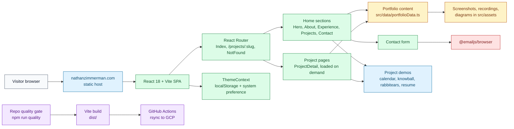
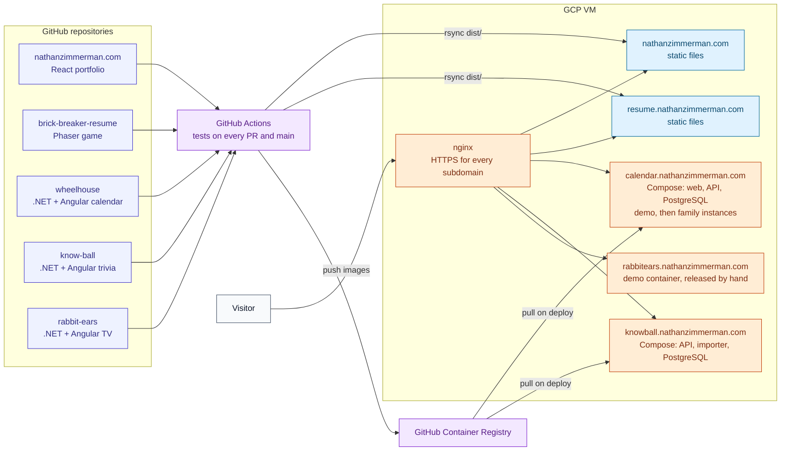

# Architecture

## Runtime Topology

The portfolio is a React 18, TypeScript, and Vite single-page application. Vite builds static assets into `dist/`, while runtime behavior is fully client-side except for third-party EmailJS contact submission.

## Architecture Diagram

## Source Boundaries

`src/pages/` owns route-level composition: `Index` for the home page, `ProjectDetail` for the project page at `/projects/:slug`, and `NotFound`. `src/components/` owns visible sections and shared UI primitives. `src/contexts/` owns app-level theme state. `src/data/portfolioData.ts` holds the featured projects (card and project page content), the earlier projects and the experience timeline, and `src/lib/` holds reusable helpers and analytics utilities.

Each featured project has a screenshot set (`npm run images:project`), a short silent MP4 in `src/assets/video/` that plays on hover and on its project page, and its containers diagram. The diagram sources in `docs/diagrams/` are copies of each project's README diagram; `npm run diagrams` renders them to `src/assets/diagrams/` with Mermaid CLI.

## Quality Gates

Run `npm run quality` from the repo root. The gate checks Prettier formatting, ESLint, TypeScript compilation, Vitest coverage thresholds, and the Playwright suite against the production build.

## Deployment Flow

GitHub Actions runs the root quality gate for pull requests and pushes to `main`. Pushes to `main` upload the built `dist/` artifact, download it in the deploy job, sync it to GCP, and verify the production site responds. The server's nginx must fall back to `index.html` for unknown paths so `/projects/<slug>` loads on a direct visit.

## Workspace Connectivity

All five projects run on one GCP VM. Its nginx terminates HTTPS for every subdomain and serves the two static sites from folders, or forwards to each app's containers on a loopback port.

Nerdle, Sudoku and Blackjack were retired in October 2026: their demos and subdomains are gone from the VM, and the portfolio lists them under Earlier projects with links to their repositories.

## Deferred Architecture Follow-Ups

Keep TypeScript strictness hardening separate from content changes. Future work can tighten `tsconfig` flags incrementally and raise the coverage thresholds toward 80%.
